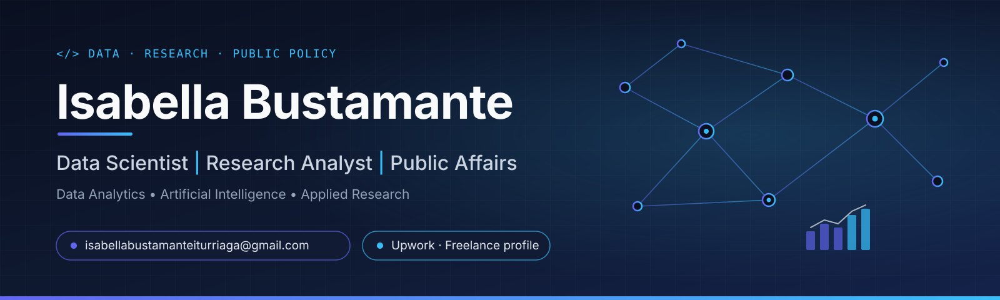

  

 

**Data Analytics • Artificial Intelligence • Applied Research**

Transforming data into actionable insights through analytics, research and AI.

---

# Featured Projects

### 🔍 RE-CHECK

AI-powered platform that transforms customer reviews into actionable business insights using Natural Language Processing and Artificial Intelligence.

**Stack**

`Python` `FastAPI` `React` `NLP`

➡️ https://github.com/isabellabustamanteiturriaga-wq/RE-CHECK

 

### 📊 Research Portfolio

Applied research developed at **CILED – Universidad del Desarrollo** focused on:

- Educational Leadership
- Gender Equity
- Public Policy
- Data Analysis

➡️ https://github.com/isabellabustamanteiturriaga-wq/research-portfolio

---

# About Me

I'm a **Data Scientist** and **Research Analyst** passionate about Artificial Intelligence, Applied Research, Public Affairs, and Business Analytics.

Recently worked as a **Data Science intern in Advanced Analytics & AI at Verisure**, contributing to Generative AI initiatives and building data-driven solutions for Customer Marketing.

I enjoy transforming complex datasets into actionable insights that drive strategic decision-making and product innovation.

---

# Tech Stack

---

# Current Interests

- Artificial Intelligence
- Generative AI
- Data Analytics
- NLP
- Customer Analytics
- Business Intelligence
- Applied Research
- Public Affairs

---

## GitHub Stats

  
  

Thanks for visiting my profile 👋

